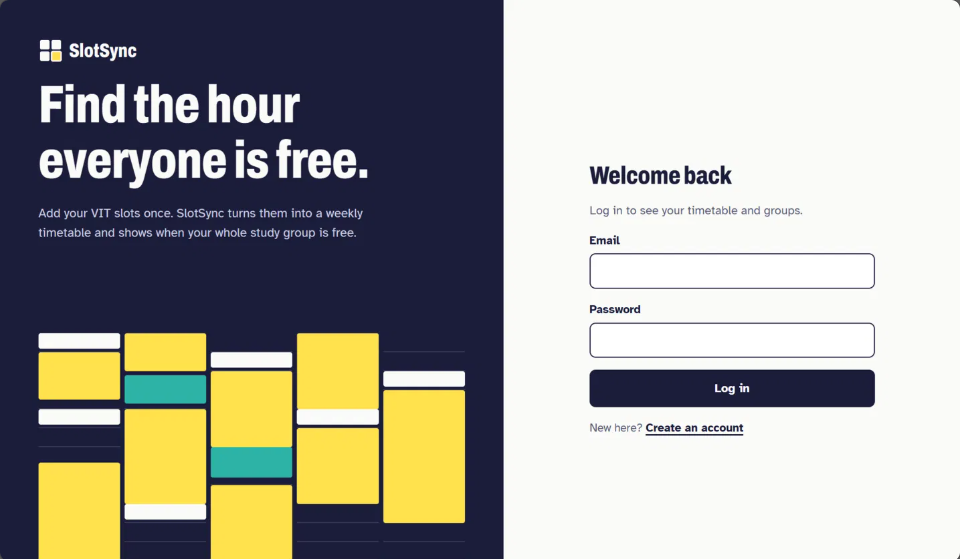
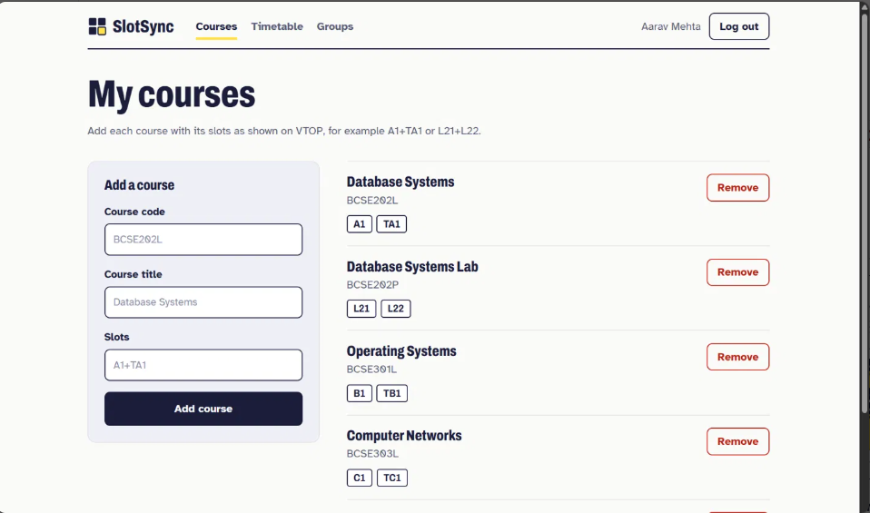
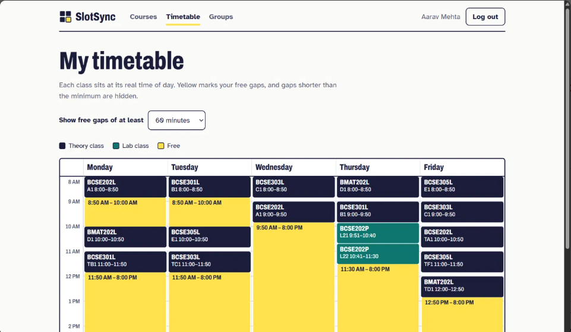
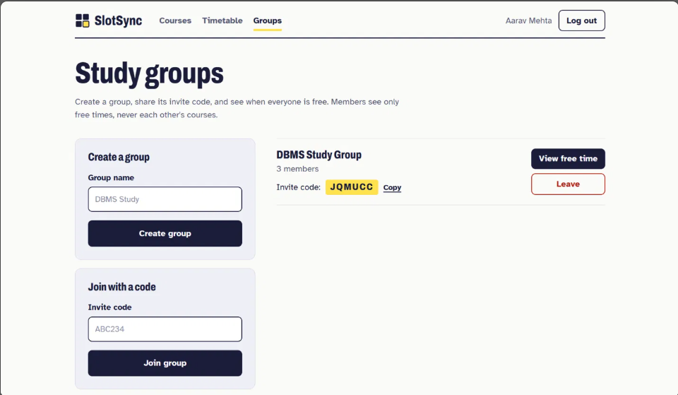
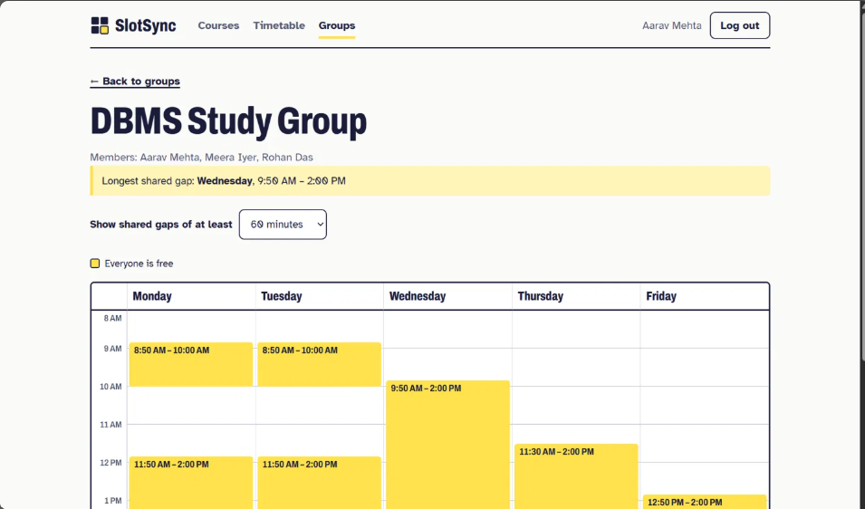
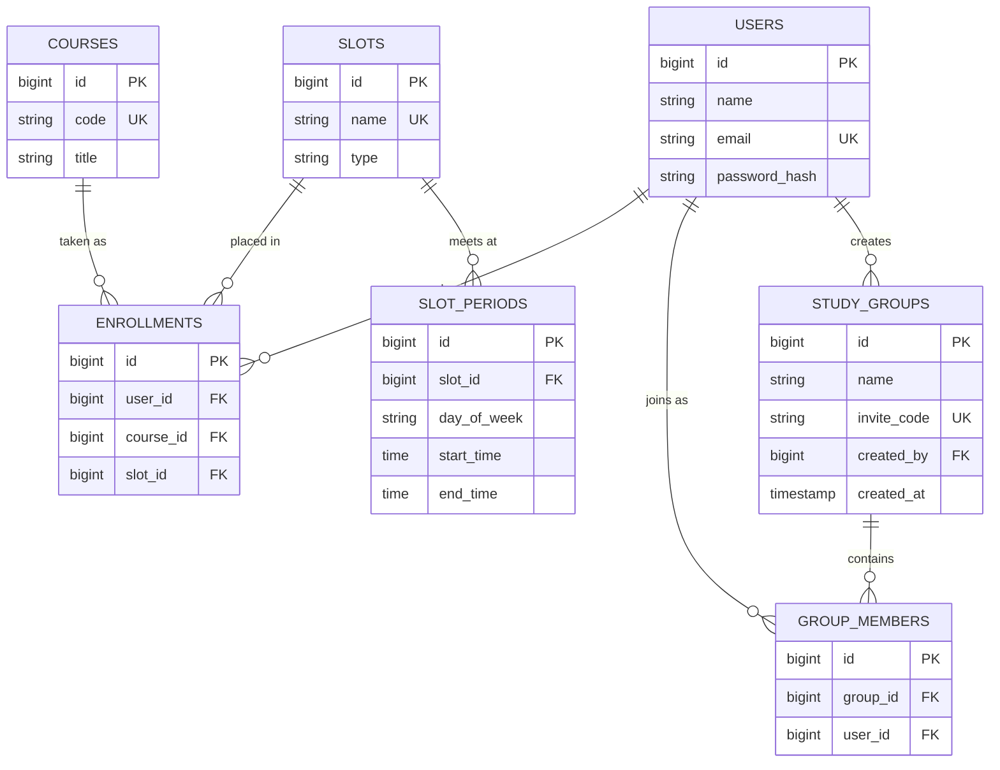

# SlotSync

SlotSync finds the hour a whole study group is free. Students enter their VIT course slots once, and SlotSync turns them into a weekly timetable and shows when everyone in a group has a gap at the same time.

VIT timetables are built from slots (A1, TB1, L21 and so on), so comparing schedules by hand is slow and error-prone. VTOP shows only your own timetable. SlotSync knows what time every slot actually meets, and does the comparison for you.



## Features

- Sign up and log in with a hashed password and a signed JWT.
- Add courses with their slots, for example `A1+TA1` or `L21+L22`. A slot can only be used once per student.
- A weekly timetable where every class sits at its real time of day. Theory and lab slots that overlap in time are shown side by side.
- Free gaps between classes, with an adjustable minimum length.
- Study groups with invite codes. A group view shows the times when **everyone** is free, plus the longest shared gap of the week.
- Privacy by design: group members see only shared free time, never each other's courses.

## Screenshots

| Courses | Timetable |
|---|---|
|  |  |

| Study groups | Group free time |
|---|---|
|  |  |

## How the free-time algorithm works

The backend turns every student's slots into time blocks for each weekday, then finds the gaps.

1. Collect the busy blocks for the day. For a group, pool the blocks of every member, because the group is busy whenever anyone is busy.
2. Sort the blocks by start time.
3. Merge blocks that overlap. VIT's lab and theory slots do not line up exactly (lab L2 runs 8:51 to 9:40, theory F1 runs 9:00 to 9:50), so overlaps are common and real.
4. Walk through the merged blocks with a cursor from 8:00 AM to 8:00 PM. Each stretch between blocks is a free window.
5. Drop windows shorter than the minimum length.

Sorting dominates the cost, so the algorithm runs in O(n log n). It is a pure Java class (`FreeTimeCalculator`) with no framework dependencies, covered by unit tests.

## Tech stack

| Layer | Technology |
|---|---|
| Backend | Java 17, Spring Boot, Spring Data JPA, Spring Security |
| Auth | BCrypt password hashing, JWT (jjwt) |
| Database | MySQL 8 |
| Frontend | React, Vite, React Router |
| Testing | JUnit 5 |

## Data model



A few choices in the schema:

- Slot timings live in their own table (`slot_periods`). One slot meets several times a week, so storing times on the slot itself would repeat data.
- `enrollments` has a unique constraint on `(user_id, slot_id)`, so the database itself rejects two courses in the same slot.
- `group_members` is a join table with a unique constraint on `(group_id, user_id)`, so nobody joins a group twice.
- The 101 VIT slots (60 lab, 41 theory) and their 115 weekly time periods are loaded from `src/main/resources/slot_periods.csv` the first time the app starts.

## API

All endpoints except signup and login need an `Authorization: Bearer <token>` header.

| Method | Path | Purpose |
|---|---|---|
| POST | `/api/auth/signup` | Create an account |
| POST | `/api/auth/login` | Log in and receive a token |
| GET | `/api/me` | The current user |
| GET | `/api/enrollments` | List my courses (one row per slot) |
| POST | `/api/enrollments` | Add a course with its slots |
| DELETE | `/api/enrollments/{id}` | Remove one of my enrollments |
| GET | `/api/timetable?minMinutes=60` | My week: classes and free gaps |
| GET | `/api/groups` | Groups I belong to |
| POST | `/api/groups` | Create a group |
| POST | `/api/groups/join` | Join a group with an invite code |
| DELETE | `/api/groups/{id}/membership` | Leave a group (an empty group is deleted) |
| GET | `/api/groups/{id}/free-time?minMinutes=60` | When everyone in the group is free |

Errors share one shape: `{ "status": 409, "message": "...", "fieldErrors": { } }`.

## Security notes

- Passwords are stored as BCrypt hashes, never in plain text.
- Sessions are stateless: a signed JWT with a two-hour expiry, checked by a filter on every request.
- Login failures return the same message for an unknown email and a wrong password, so accounts cannot be probed.
- Secrets (database password, JWT signing key) live in a git-ignored `application-local.properties`.
- CORS only allows the origins listed in `app.cors.allowed-origins`.
- Every enrollment lookup is scoped to the logged-in user, so one student cannot delete another's data.
- A group's free-time endpoint returns 404 for non-members, whether or not the group exists.

## Getting started

### Prerequisites

- JDK 17
- MySQL 8
- Node.js (LTS)

### 1. Clone and create the database

```bash
git clone https://github.com/Kirtika-Agrawal/slotsync.git
cd slotsync
```

In MySQL:

```sql
CREATE DATABASE slotsync;
```

### 2. Add your private settings

Create `src/main/resources/application-local.properties`. It is git-ignored, so your secrets stay on your machine.

```properties
spring.datasource.url=jdbc:mysql://localhost:3306/slotsync
spring.datasource.username=root
spring.datasource.password=YOUR_MYSQL_PASSWORD
spring.jpa.hibernate.ddl-auto=update
app.jwt.secret=PASTE_A_BASE64_SECRET_HERE
app.jwt.expiration-minutes=120
```

Generate a signing key with:

```bash
openssl rand -base64 32
```

### 3. Run the backend

```bash
./mvnw spring-boot:run
```

It starts on `http://localhost:8080` and loads the slot data on first run.

### 4. Run the frontend

```bash
cd frontend
npm install
npm run dev
```

Open `http://localhost:5173`.

### 5. Optional: load demo data

With the backend running:

```bash
bash scripts/seed-demo.sh
```

This creates three students with clash-free timetables and one study group. Log in as `aarav@example.com`, `meera@example.com` or `rohan@example.com` with the password `demopass123`.

## Tests

The free-time algorithm has unit tests:

```bash
./mvnw -Dtest=FreeTimeCalculatorTest test
```

## Project structure

```
slotsync/
├── src/main/java/com/kirtika/slotsync/
│   ├── algorithm/     interval merging and free-window calculation
│   ├── config/        slot data loader, password encoder
│   ├── controller/    REST endpoints
│   ├── dto/           request and response shapes
│   ├── exception/     consistent error responses
│   ├── model/         JPA entities
│   ├── repository/    Spring Data repositories
│   ├── security/      JWT service, auth filter, security rules
│   └── service/       business logic
├── src/main/resources/slot_periods.csv
├── frontend/          React app
├── scripts/           demo data
└── docs/screenshots/
```

## Design decisions and limitations

- **Token storage.** The JWT is kept in `localStorage`, which keeps the frontend simple but is exposed to cross-site scripting. An httpOnly cookie would be the stronger choice for a production system.
- **Slot data is static.** The timetable comes from VIT's published slot chart. If the chart changes, update `slot_periods.csv`.
- **Clashes between different slots.** The database stops two courses in the same slot, but two different slots that overlap in time are not rejected. VIT's registration system already prevents this for real students.
- **Fixed day window.** Free time is calculated between 8:00 AM and 8:00 PM, Monday to Friday.

## Ideas for later

- Study buddy suggestions: students in the same course who share free time, opt-in only.
- Detecting overlapping slots when a course is added.
- Moving the token to an httpOnly cookie.
